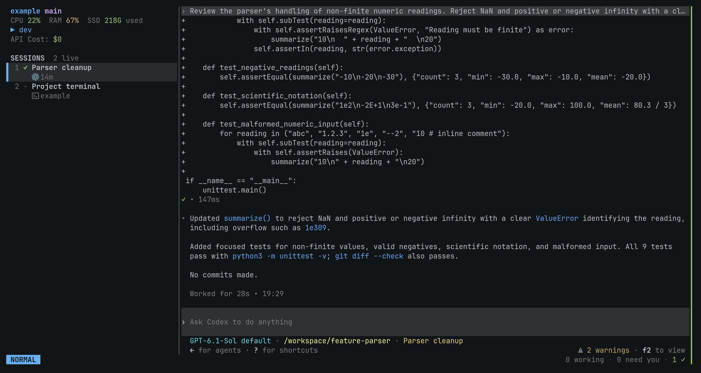
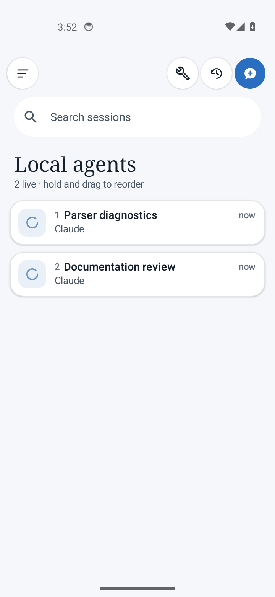
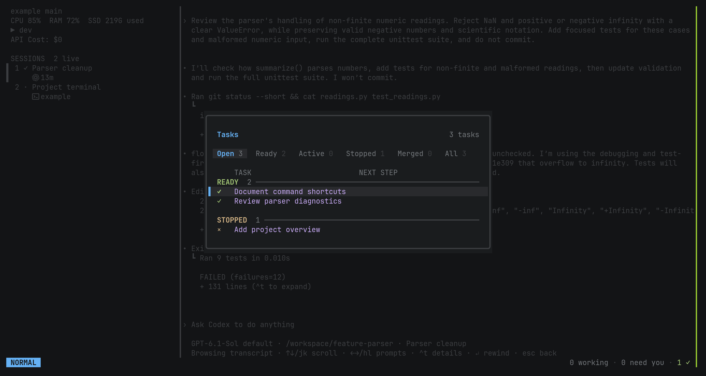
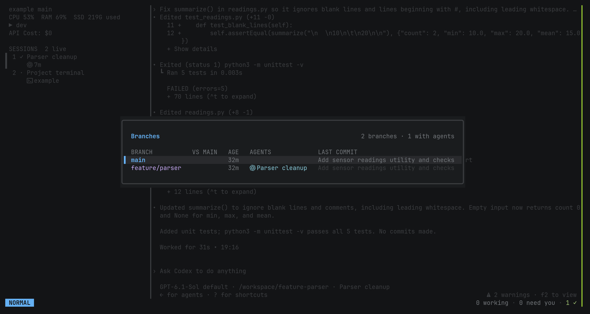

# Cepheus

A terminal workspace for AI coding agents. Keep Claude Code, Codex, Antigravity,
Grok, opencode, custom providers, and ordinary terminals in one window. A
background Rust service owns their terminals, so closing the view leaves work
running. An optional native Android app controls the same sessions remotely.

[All screenshots](docs/screenshots/README.md) ·
[Android app](android/README.md) ·
[Plugins](plugins/README.md) ·
[Tasks dashboard](lua/tasks.md) ·
[Lua API](skills/cepheus-plugin/api.md) ·
[License](LICENSE)

## Screenshots





The [screen gallery](docs/screenshots/README.md) covers the desktop and Android
interfaces in isolated demo workspaces. Desktop captures show the running TUI
with a real Codex session, Git worktrees and Markdown tasks. No owner projects,
credentials or private conversations appear.
The desktop follows your terminal's palette and font. Android starts in dark
mode; Light and System default remain available in Settings.

### Tasks



### Branches



The [complete desktop gallery](docs/screenshots/DESKTOP.md) also shows the queue,
chores, machines, usage, session controls, plugin pickers and command overlays.

## What it does

- Switch between agents and terminals while preserving their real terminal
  output, scrollback, colors, cursor, and running processes.
- See session activity, requests for input, completed work, subagents, resource
  usage, provider usage, and Git branches in one sidebar.
- Resume saved conversations, search history, send messages through supported
  native provider interfaces.
- Connect multiple Linux hosts over authenticated TLS; start agents on another
  host or send builds and test shards to disposable Podman containers.
- Run headless jobs, dependent work queues, recurring chores, and captured-target
  idle messages with persistent delivery receipts.
- Extend the UI and service with Lua commands, keymaps, sidebar sections,
  provider adapters, and optional bundled plugins.
- Pair a native Android companion using a short-lived QR code and a pinned TLS
  certificate. Read chats, answer questions, attach files, and manage sessions.

## Build

Cepheus targets Linux. Install a current stable Rust toolchain and a C compiler
with the usual build tools. SQLite and Lua are compiled into the application.
Install the `sqlite3` command for Codex goal status and opencode session titles.

```sh
cargo build --release --locked
./target/release/cepheus --help
./target/release/cepheus
```

Install the agent clients you want separately and sign in through their own
login flows. Cepheus invokes `claude`, `codex`, `agy`, `grok`, or `opencode`
from your PATH. It can also host your login shell with no AI client installed.

For installation into `~/.local/bin`:

```sh
./target/release/cepheus install
```

A terminal supporting true color is recommended. Kitty additionally supports
image display and desktop integration. Desktop notifications use `notify-send`
when available. Multi-host setup uses SSH; build offloading also needs `rsync`,
rootless Podman, and a provisioned tools image on the build hosts. These are
optional for local sessions.

## First session

Run `cepheus` from your project directory. Enter `:new codex` or
`:new claude` to start an agent, or `:term` for a shell. Use the sidebar to
select a session. Enter `:help` for the interactive help and `:help commands`
for the complete command catalog. `cepheus keys` lists the current shortcuts.

Useful commands:

| Command | Purpose |
| --- | --- |
| `:new codex` | Start a local Codex session |
| `:new claude worker` | Start Claude on the enrolled host named `worker` |
| `:term` | Open a terminal |
| `:resume` | Browse saved conversations |
| `:branches` | Inspect branches across hosts |
| `:tasks` | Browse configured task sources and their task states |
| `:machines`, `:usage` | Machine resources and provider usage |
| `:broadcast Review the current requirements` | Message working agents |
| `:jobs`, `:queue`, `:chores`, `:slots` | Inspect background work and scheduling |
| `:supervisor` | Inspect attention delivery and optional supervisor policy |
| `:lua`, `:reload` | Run Lua and reload Lua configuration |
| `:q` | Close the view while sessions keep running |

`cepheus stop` stops an empty service and refuses while sessions remain live.
`cepheus restart` performs an in-place service handover that retains sessions.

## Configuration

Configuration lives in `~/.config/cepheus/config.json`. A neighboring
`profile.json` can supply local defaults; explicit configuration takes
precedence. `CEPHEUS_CONFIG` selects another configuration file. Normal XDG
configuration, data, cache, state, and runtime locations are supported.

Start with [examples/config.json](examples/config.json). No checkout path,
project server, network host, signing key, or personal profile is included.
Without `start_dir`, Cepheus resolves the current repository. Default agent
commands add no permission-bypass flags. The phone gateway is disabled, and
its default listener is loopback.

```json
{
  "sidebar_width": 34,
  "notifications": true,
  "claude_command": ["claude"],
  "codex_command": ["codex"],
  "remote": false
}
```

Enable only the integrations you intend to use. `sync_logins` controls sign-in
synchronization between enrolled hosts; `short_titles` controls model-generated
short titles. Local `init.lua`, `plugins/*.lua`, and `lua/` modules live beside
the configuration file. See [lua/init.example.lua](lua/init.example.lua) and the
[plugin API](skills/cepheus-plugin/api.md).

Optional packages stay in this repository with their helpers and installation
instructions. Preview installation before applying it:

```sh
python3 tools/install_plugins.py --list
python3 tools/install_plugins.py agent-limit agent-plugins --dry-run
python3 tools/install_plugins.py agent-limit agent-plugins
```

## Hosts, builds, and automation

Enroll a machine with `cepheus hosts install worker --ssh user@worker.example`.
Use a dedicated automation SSH identity and retain your ordinary login access.
`cepheus hosts` shows enrolled endpoints. Hosts that only run builds need no
agent sessions or copied provider sign-ins.

Build offloading expects a suitable tools image named by
`offload.container.image` in your configuration. The default name is
`localhost/cepheus-offload:latest`; provision that image on each selected host
with the compilers and runtimes your project needs. Commands run in disposable
rootless containers, with source copied from the current Git checkout.

```sh
cepheus run --host worker -- cargo test --release --locked
cepheus shard --runner pytest tests/
cepheus agent list
cepheus ctl status
```

Python environment preparation and CI shard selection are project-configurable
through `offload`; plain commands do not need Python project files. See the
[bundled operational skill](skills/cepheus/SKILL.md) for command details and
[generic task sources](lua/task_sources/README.md) for optional read-only
Markdown and GitHub Issues inputs. Repository-specific integrations and private
operations dashboards are excluded from this distribution.

## Development

See [CONTRIBUTING.md](CONTRIBUTING.md) for verification commands, screenshot
tooling, and current test-suite limitations.
The source is self-contained: `src/` contains the Rust service and TUI,
`plugins/` contains bundled integrations, `lua/` contains Lua helpers,
`skills/` contains embedded agent documentation, and `android/` contains the
standalone Gradle project. No parent repository is required.

## License

MIT, copyright 2026 Andromeda1957. Third-party components retain their own
licenses; see [THIRD_PARTY_NOTICES.md](THIRD_PARTY_NOTICES.md).
